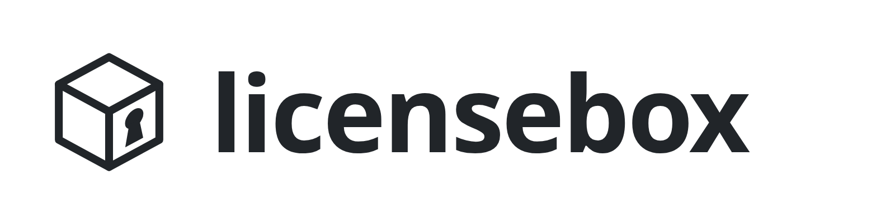

<picture>
  <source media="(prefers-color-scheme: dark)" srcset=".github/logo-dark.png">
  
</picture>

# licensebox for Go

The Go client for [licensebox](https://licensebox.dev): your app signs the
user in once, by email, then checks the licence with licensebox at every
run. When licensebox can't be reached, the signed lease kept on the machine
lets the app run offline until it expires, a day by default.

licensebox manages licensing and access. Admins decide who gets access;
any payments or billing are handled separately by the product's team.

```
go get licensebox.dev/client
```

```go
// The product's public key, as `licensebox config myapp` prints it. It is
// about 2.7 KB, so keep it in its own file (keys.go) or embed it.
const myappKey = "ed25519-mldsa65:K3T9…"

lic, err := client.New(client.Config{
	Product: "myapp",
	Keys:    lease.Keys{"myapp-2026a": lease.MustKey(myappKey)},
	Version: version,
})
if err != nil {
	return err
}
if _, err := lic.Require(ctx, "export"); err != nil {
	return err // says which module is missing, and for whom
}
```

- `client`: sign-in, storage of the lease and the installation's key,
  checks at every run, offline checks.
- `lease`: the lease format, for checking leases without the client.
- `cmd/signin`: signs in to a product and prints the lease, for trying a
  product's set-up.
- `admin`: the admin API, for automating access decisions such as granting
  modules after an admin approves a request.
- `cmd/licensebox`: the admin command: create products, grant modules,
  revoke users and machines, delete products (after seven days, to be
  taken back until then).

```
go install licensebox.dev/cmd/licensebox@latest
licensebox login you@example.org
licensebox create myapp -modules core,export -free core
licensebox grant myapp ada@example.org export -until 2027-01-31
```

## Access requests and usage

```go
modules, err := lic.Modules(ctx) // names, descriptions, held and pending
request, err := lic.RequestAccess(ctx, []string{"export"}, "exporting brackets")
url, err := lic.AccessLink(ctx) // private browser form, valid 15 minutes
// After a command finishes; sent with the next run's check if enabled.
lic.Record("export", err == nil, time.Since(start))
```

Admins can list and answer requests on the product page or from the CLI:

```
licensebox product myapp -describe "export: STEP and IGES export" -usage on
licensebox requests myapp
licensebox approve myapp REQUEST export -days 30
licensebox decline myapp REQUEST -note "Please tell us more"
licensebox usage myapp -days 30
```

Usage is off by default. With disclosure in your app's terms and docs,
reports include command names, outcomes, durations, version and operating
system, associated with the signed-in user and machine. Never pass filenames,
arguments or file contents to `Record`. Counts are queued locally, sent on
the next run and safe to retry; signing out discards the queue.

Version 0.5 changes signed app calls to include the operation and payload
hash. Upgrade client and server together; see the HTTP guide for the envelope.

Version 0.8 speaks protocol v3: every signature, by the product's keys and by
the installation's key, is Ed25519 and ML-DSA-65 (FIPS 204) together, and both
must verify, so a quantum computer that breaks Ed25519 cannot forge a lease.
Keys are written `ed25519-mldsa65:<base64url>`. It is a clean break: v2 keys,
leases and installation keys are refused, and every product gets new keys.

Standard library only (`crypto/mldsa`, Go 1.26 or later). `crypto/mldsa` is
not available under the FIPS 140-3 Go Cryptographic Module v1.0.0; with that
module selected, key generation and verification fail. The developer guide, and the HTTP API for other languages, is at
[licensebox.dev/docs](https://licensebox.dev/docs); the admin guide at
[licensebox.dev/docs/admin](https://licensebox.dev/docs/admin).

MIT licence.

## Machine seats and location policies

Licensebox enforces policies centrally for every product. Set `MachineLimit` and
`Locations` through the admin API, web console, or CLI (`-machine-limit`,
`-allow-areas`, `-block-areas`). Zero seats means unrestricted installations.
A completed sign-in at capacity transfers the oldest seat; renewal cannot take
it back. New web/CLI-created products default to one seat; products without
an explicit machine policy migrate to one seat. Explicit zero remains unrestricted. Countries, cities within countries, and radius areas can
be allowed or blocked. IP location is approximate; blocks take precedence and
missing required metadata fails closed.

Handle `client.ErrSeatTransferred` and `client.ErrLocationDenied` like other
authorization failures, before performing work. The SDK persists these refusals
until renewal or explicit sign-in succeeds and never bypasses them offline.
An offline machine can keep using a previously issued lease until expiry.
Expiry requires connectivity, not another email code, even after a long idle
period. A native machine binding now accompanies the key; see the machine identity guide.

The public integration guide is available at https://licensebox.dev/llms.txt.

Machine binding is enforced by the SDK before both online and offline use,
and by the server on signed device, token and app requests. Raw identifiers
never leave the host. New keys on the same native machine replace its existing
seat; deleting keys cannot evade a machine revocation. Native-ID spoofing or
full VM clones remain possible; this is not hardware attestation.

## Optional heartbeats for long-running work

`Require` checks at command start and does not create a background task. For a
long-running job, call `lic.Heartbeat(ctx, "export")` at your chosen checkpoints.
It forces a bounded online renewal, even with a fresh cached lease, and reports
`result.Online`. Eligible outages can use the last verified lease until its
signed expiry; refusals never use that fallback. Heartbeat never opens sign-in
or creates a replacement installation key. Sign in explicitly before starting.

For a cancellable Go task, opt into a monitor:

```go
work, stop, err := lic.Watch(ctx, "export", client.WatchOptions{})
if err != nil {
    return err
}
defer stop()
return runJob(work) // observe cancellation at safe checkpoints
```

Inspect `context.Cause(work)` for the refusal or expiry reason. The monitor
signals cancellation; your application owns checkpointing and shutdown. Its
expiry watchdog runs independently of HTTP requests and optional `OnCheck`
callbacks. Callbacks must return promptly and must not contain the protected job.
No app process is killed automatically.

Admins can set a product's maximum check interval and contact grace period:

```sh
licensebox product myapp -heartbeat-interval 300 -heartbeat-grace 900
licensebox product myapp -heartbeat-interval 0 # disable policy
```

The policy is off by default. Enabled intervals are 30–86,400 seconds; grace
must be at least the interval and no more than 365 days. Every new lease expires
within the grace period (or an earlier offline/grant limit), including for older
clients. `Watch` uses the signed interval unless the caller chooses a faster
one. The policy does not start a monitor in an application that never opts in.
An offline client discovers a new revocation at contact or signed expiry.

## Seats per module

A module can have seats of its own, overriding the product's for that module
(`licensebox product myapp -module-seats server=1`). It is in a machine's lease
only while that machine holds one of its seats; elsewhere the lease lists it in
`Elsewhere`, and `Require` returns a `*client.ModuleError` with `Elsewhere` set,
whose message says that an explicit sign-in here moves the seat.

## Floating copies

A customer can hold a pool of floating copies of a module
(`licensebox customer add myapp acme -pools solver=5`). The lease lists such
modules in `Floating`. `Require` checks a copy out when the module is not held
outright, and returns `client.ErrNoFreeCopy` when every copy is in use. Keep
the copy with `Heartbeat` or `Watch` while the work runs, and return it after:

```go
if _, err := lic.Require(ctx, "solver"); err != nil {
    return err // ErrNoFreeCopy: all copies in use
}
defer lic.Checkin(context.Background(), "solver")
work, stop, err := lic.Watch(ctx, "solver", client.WatchOptions{})
if err != nil {
    return err
}
defer stop()
return solve(work)
```

`Checkout` takes a copy explicitly. A copy lives only as long as the lease, so
floating modules need the product's heartbeat and a connection; a crashed app
frees its copy when the grace passes, and a heartbeat takes a lapsed copy again
if one is free. Copies are counted per installation, not per process.

## Service accounts

A server or build runner can be licensed in its own name. An admin creates the
account and issues a one-time token (`licensebox service add myapp acme
build-1`, `licensebox service token myapp build-1`). Set it on the machine as
`LICENSEBOX_ENROL_TOKEN`, or as `client.Config.Token`; the first `Require`,
`Lease` or `SignIn` enrols the machine without a browser. `lic.Enrol(ctx,
token)` does it explicitly. A used or expired token returns
`client.ErrEnrolment`. A new token enrols a new machine and revokes the one
before.
