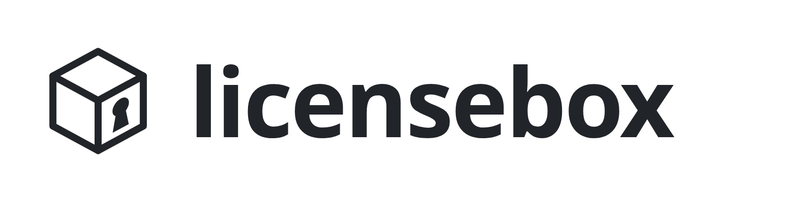

<picture>
  <source media="(prefers-color-scheme: dark)" srcset=".github/logo-dark.png">
  
</picture>

# licensebox for Go

The Go client for [licensebox](https://licensebox.dev): your app signs the
user in once, by email, then checks the licence with licensebox at every
run. When licensebox can't be reached, the signed lease kept on the machine
lets the app run offline until it expires, a day by default.

```
go get licensebox.dev/client
```

```go
lic, err := client.New(client.Config{
	Product: "myapp",
	Keys:    lease.Keys{"myapp-2026a": lease.MustKey("K3T9…")},
	Version: version,
})
if err != nil {
	return err
}
if _, err := lic.Require(ctx, "export"); err != nil {
	return err // says which module is missing, and for whom
}
```

- `client`: sign-in, storage of the lease and the installation's key,
  checks at every run, offline checks.
- `lease`: the lease format, for checking leases without the client.
- `cmd/signin`: signs in to a product and prints the lease, for trying a
  product's set-up.
- `admin`: the admin API, for automating what admins do, as granting a
  module when a payment comes in.
- `cmd/licensebox`: the admin command: create products, grant modules,
  revoke users and machines.

```
go install licensebox.dev/cmd/licensebox@latest
licensebox login you@example.org
licensebox create myapp -modules core,export -free core
licensebox grant myapp ada@example.org export -until 2027-01-31
```

## Access requests and usage

```go
modules, err := lic.Modules(ctx) // names, descriptions, held and pending
request, err := lic.RequestAccess(ctx, []string{"export"}, "exporting brackets")
url, err := lic.AccessLink(ctx) // private browser form, valid 15 minutes
// After a command finishes; sent with the next run's check if enabled.
lic.Record("export", err == nil, time.Since(start))
```

Admins can list and answer requests on the product page or from the CLI:

```
licensebox product myapp -describe "export: STEP and IGES export" -usage on
licensebox requests myapp
licensebox approve myapp REQUEST export -days 30
licensebox decline myapp REQUEST -note "Please tell us more"
licensebox usage myapp -days 30
```

Usage is off by default. With disclosure in your app's terms and docs,
reports include command names, outcomes, durations, version and operating
system, associated with the signed-in user and machine. Never pass filenames,
arguments or file contents to `Record`. Counts are queued locally, sent on
the next run and safe to retry; signing out discards the queue.

Version 0.5 changes signed app calls to include the operation and payload
hash. Upgrade client and server together; see the HTTP guide for the envelope.

Standard library only. The developer guide, and the HTTP API for other languages, is at
[licensebox.dev/docs](https://licensebox.dev/docs); the admin guide at
[licensebox.dev/docs/admin](https://licensebox.dev/docs/admin).

MIT licence.
